# Beli's SkyLyrics

Synced lyrics for the song you're listening to, glowing in the Minecraft sky.
A free, open-source Fabric mod for Minecraft 1.21.6 to 1.21.8, 1.21.9 and 1.21.10, 1.21.11, 26.1, 26.2 and 26.3.

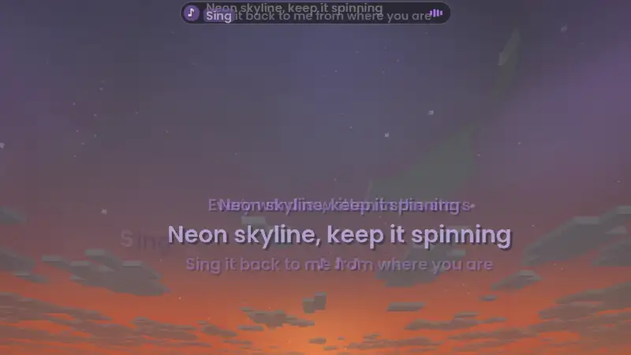

<sub>Short clip: [docs/demo.mp4](docs/demo.mp4). The lyrics in all pictures are made up for the built-in demo song.</sub>

Download it from the [Releases page](https://github.com/arbelonson-source/belis-skylyrics/releases). Questions? See the [FAQ](docs/FAQ.md). Something not working? See [Troubleshooting](docs/TROUBLESHOOTING.md).

## What it does

- Sees what's playing on your PC: Spotify, a browser tab, or any other player that shows up in your media controls. Works on Linux and on Windows 10 and 11. On macOS it works with the Spotify and Apple Music apps.
- Gets the synced lyrics from [LRCLIB](https://lrclib.net) and shows them line by line, in time with the song.
- Three layouts. **Arc** shows the line being sung on a gentle curve, each word tilted a little. **Lines** shows the previous, current and next lines, straight and centred. **World** places each word or two in the world around you as it's sung.
- In the **World** layout, words can flow into a line that glides in and lands with a flash. Each row bows gently, like handwriting across the sky. They keep clear of the middle of your view, slide out of each other's way, never sink into blocks, and move off other players (handy in PvP). Hit a word to knock it back. When you die, the words drop out of the sky, spinning as they fade. You choose how words arrive (pop, drop, zoom, fade in, or typed letter by letter) and how they leave (shrink, float up, blow away, sink or dissolve). Their glow is a deeper shade of the letters' colour, like neon, and **Soft edges** drops the dark outline for the softest look. Most of these can be turned off under **Position**.
- **Sky mode** puts the lyrics far away in the sky. **Floating mode** keeps them in front of you.
- Words fade in one by one and light up as they are sung. Five other line animations are included, plus an optional glow pulse on each new line.
- A bar at the top of the screen shows the round cover and the line being sung, with the current word highlighted. A clock sits on its left, and your ping and frames per second on its right. Each can be turned off on its own, and the cover can spin slowly like a record.
- An optional **Record card** sits in a corner of your choice: a spinning vinyl with the album cover in the middle, the song title and artist, and a progress line with the time played and the song length, with the line being sung on a strip underneath. It keeps clear of your hotbar and your potion effect icons.
- The word being sung can grow a little in the sky (optional).
- Five letter styles for the sky lyrics: Bold, Smooth, Round, Handwritten or the Minecraft font. **Depth** gives the letters a solid edge, so they look raised, like 3D.
- A soft periwinkle colour at first, with more soft colours to pick from. It can also take its colour from the album cover, follow the time of day (warm at sunrise and sunset, lilac at night), change with each new line, or use rainbow. **Two-tone** makes each line fade from your colour into a second one. The glow around the letters can have its own colour.
- At night, a sky of your choice can fill in behind the lyrics while music plays: an aurora, a nebula, **Synthwave** (a purple sky with a striped retro sun), **Eclipse** (a dark sun with a glowing ring), **Moonlight** (a big full moon over drifting clouds), **Galaxy** (a slowly turning spiral galaxy), **Comet** (a bright comet with two glowing tails), or **Random** for a different one with each song. **Constellations** join some of the stars with thin lines. **Pulse with the lyrics** makes the sky brighten for a moment with each new line.
- When a new song starts, its name and artist can float up in the sky.
- A hat for your character, seen in third person (F5): halo, neon headphones, conical hat, crown, cat ears, pumpkin head, top hat, devil horns, neon shades, antennae, a flower crown, a propeller cap or music notes circling your head, with parts that glow in your lyrics colour. Only you can see it.
- Crosshair styles: Minecraft's normal one, or a dot, cross, circle, corners, music note, heart or diamond in your lyrics colour. They can flash brighter as each new lyric line starts.
- A **song library** (press **N**) with your Spotify liked songs and playlists. Show it as a grid, a shelf or a carousel. Search, then click a song to play it. Sign in to Spotify on the **Music** tab first.
- Lyrics come early or late? Fix the timing once and it's remembered for that song.
- Works with Sodium and Iris shaders. The smooth letters stay smooth with shader packs on. The **Draw on top** setting keeps the lyrics bright and in front of shader clouds, rain and fog.
- A settings screen with a live preview and play/pause/next buttons. Open it with **J** or through Mod Menu.
- A demo mode with a built-in song, so you can try it without any music playing.
- Hebrew and Arabic lyrics are written from the right, with Arabic letters joined properly.
- A short welcome tour the first time you start the game helps you pick a layout, a look and your music.
- Updates itself: a new version downloads in the background and a pop-up tells you to restart Minecraft. On the **About** tab you can set **Updates** to **Tell me** for just a notice, or turn it off.
- English and Hebrew. The settings follow your Minecraft language.

## Pictures

| | |
|---|---|
| 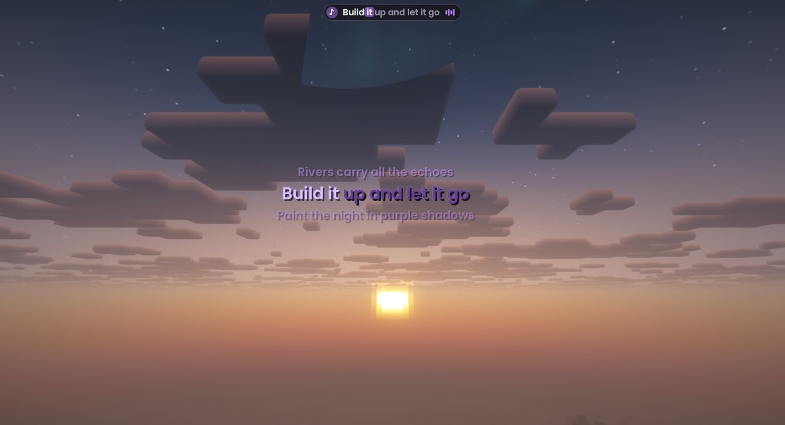 | 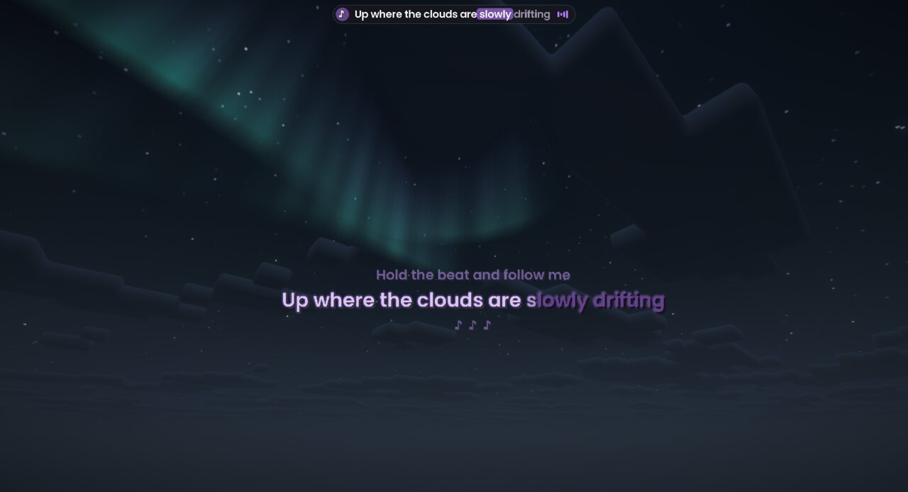 |
| Sunset, with shaders | Aurora at night, with shaders |
| 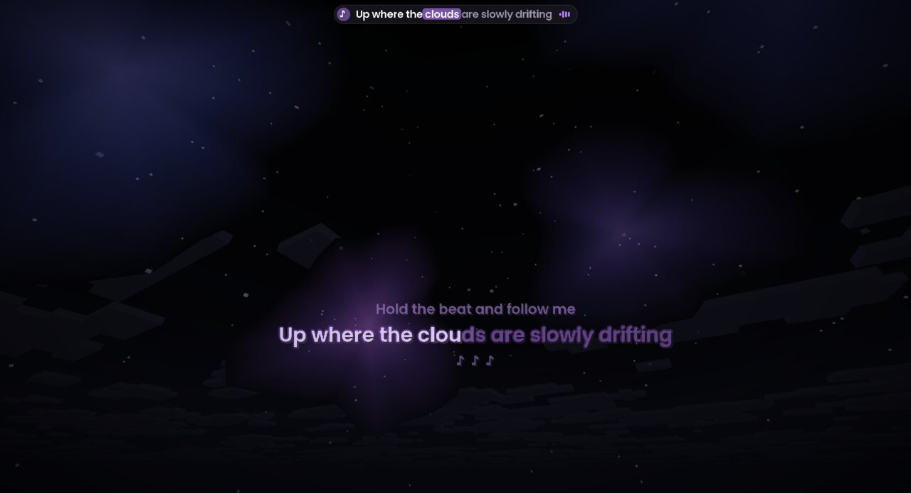 | 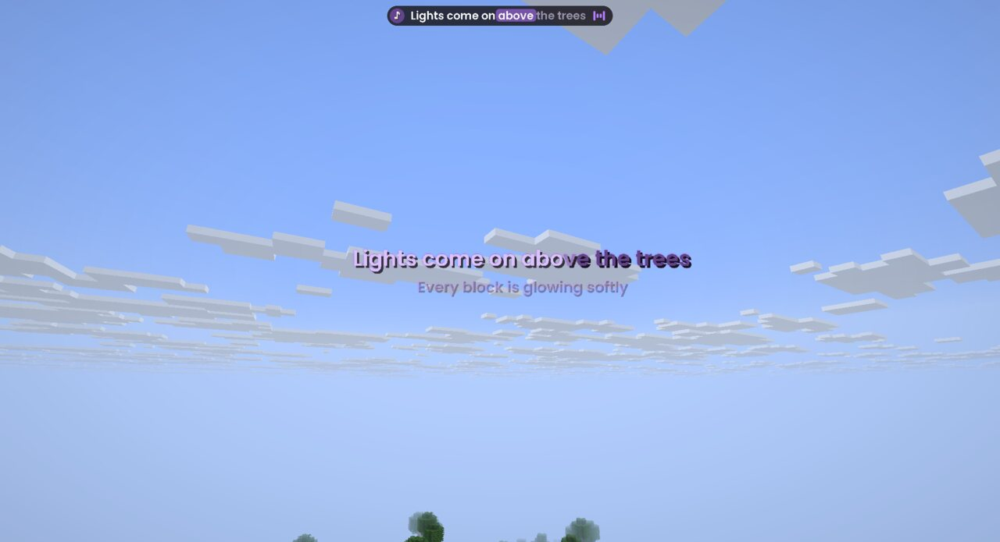 |
| Nebula at night | Daytime, no shaders |
| 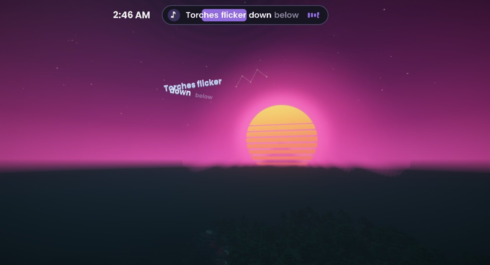 | 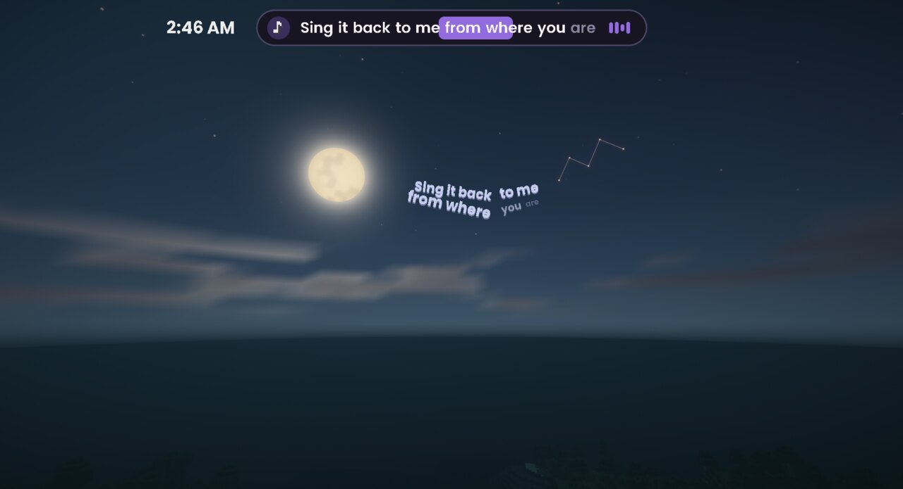 |
| Synthwave sky, with shaders | Moonlight sky, with shaders |
| 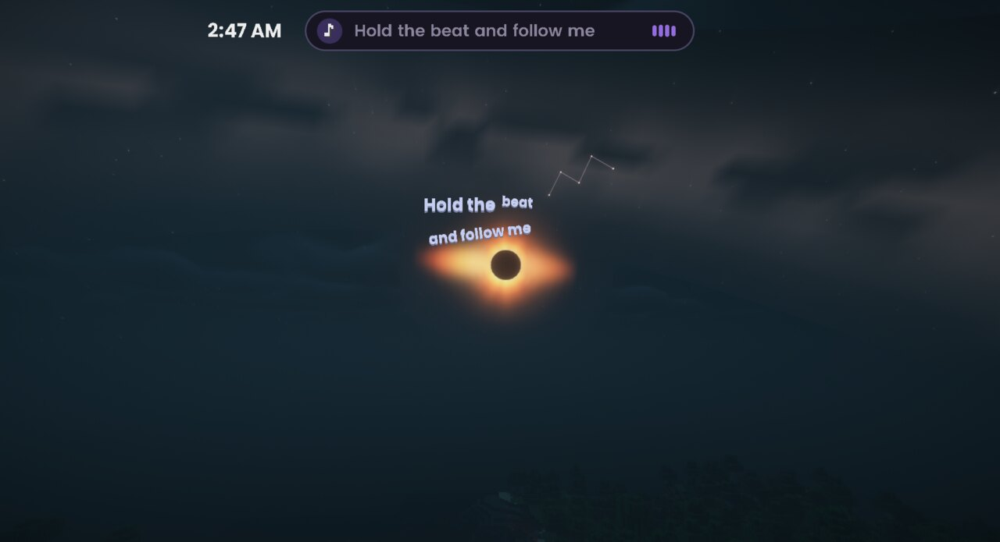 | 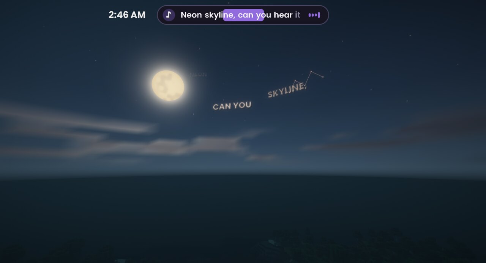 |
| Eclipse sky, with shaders | World layout: words flowing across the aurora |
| 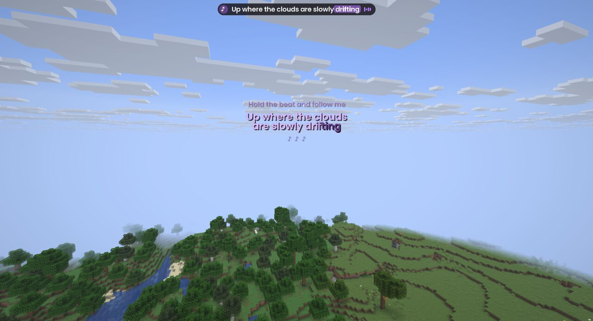 | 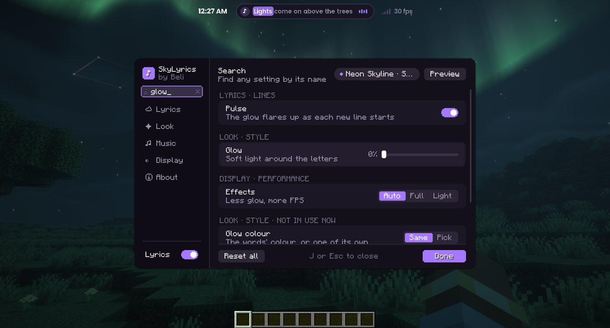 |
| Floating mode, close by | The settings screen, searching for "glow" |
| 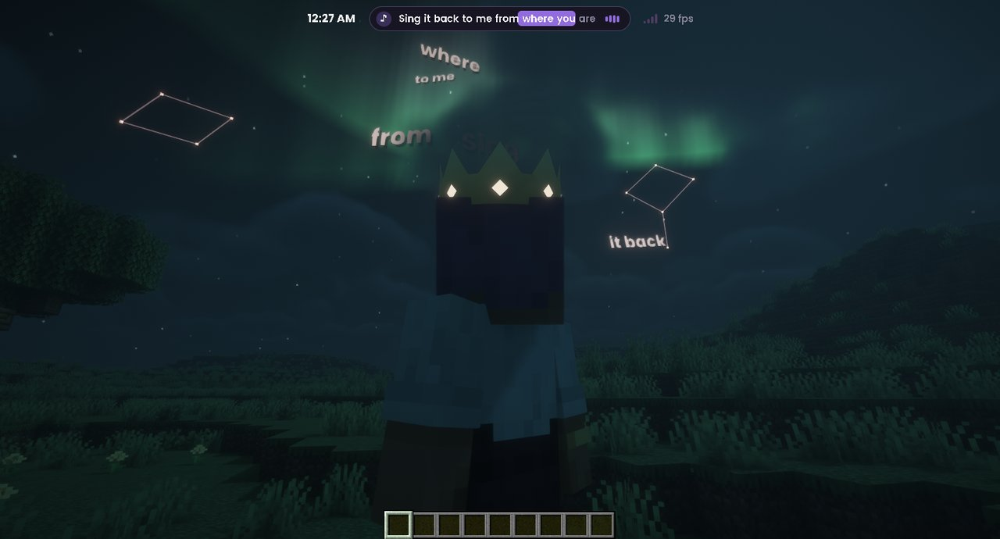 | 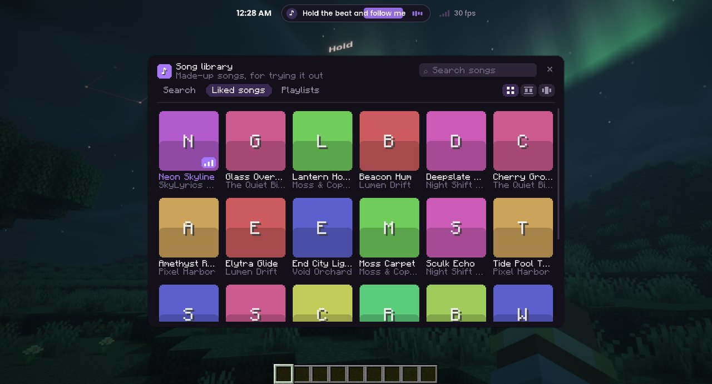 |
| A crown hat, seen from behind | The song library (made-up songs shown) |

## Install

Each release has one jar per Minecraft version. Pick the one whose name ends in your version: `+1.21.8.jar` (for 1.21.6, 1.21.7 and 1.21.8), `+1.21.10.jar` (for 1.21.9 and 1.21.10), `+1.21.11.jar`, `+26.1.jar` (for 26.1, 26.1.1 and 26.1.2), `+26.2.jar` or `+26.3.jar`.

Works on **Linux**, **Windows 10 or 11** and **macOS**. On Linux the mod finds your song through MPRIS. On Windows it reads the media controls that pop up when you press a media key. On macOS it works with the **Spotify** and **Apple Music** apps only, not browsers or other players. The first time, macOS asks whether Minecraft may control them: click **OK**.

### With Prism Launcher (easiest)

1. Click **Add Instance**, pick Minecraft **1.21.8**, **1.21.10**, **1.21.11**, **26.1.2**, **26.2** or **26.3**, and choose **Fabric** as the mod loader.
2. Select the instance, click **Edit**, then open **Mods**.
3. Click **Download mods** and add **Fabric API**. You can also add **Sodium**, **Iris** and **Mod Menu** if you like.
4. Click **Add file** and pick the SkyLyrics `.jar` for your Minecraft version from the [Releases page](https://github.com/arbelonson-source/belis-skylyrics/releases).
5. Start the game, play a song in Spotify or your browser, and look up.

### With the official launcher

1. Run the [Fabric installer](https://fabricmc.net/use/installer/) and install Fabric for **1.21.8**, **1.21.10**, **1.21.11**, **26.1.2**, **26.2** or **26.3**.
2. Download [Fabric API](https://modrinth.com/mod/fabric-api) and the SkyLyrics `.jar` for your Minecraft version.
3. Put both files in your `mods` folder. Create it if it doesn't exist.
   - Linux: `~/.minecraft/mods`
   - Windows: `%appdata%\.minecraft\mods` (paste this into the File Explorer address bar)
   - macOS: `~/Library/Application Support/minecraft/mods` (in Finder, choose **Go → Go to Folder…** and paste this)
4. In the launcher, pick the **fabric-loader** profile for your version and press Play.

### Using it

- **J** opens the settings and **N** opens the song library. Change the keys under *Options → Controls → Key Binds → Beli's SkyLyrics*.
- The same place has optional keys for play/pause, next and previous song, and "lyrics are early / late" for the song playing now.
- No lyrics showing? Open the settings and look at the **Music** tab. It tells you which player it's following and whether lyrics were found. Some songs simply have no lyrics on LRCLIB. More help in [Troubleshooting](docs/TROUBLESHOOTING.md).

## Building it yourself

Gradle needs Java 25 to run. One source tree builds a jar for every supported Minecraft version with [Stonecutter](https://github.com/stonecutter-versioning/stonecutter): the code in `src/` is written for 1.21.11, and comments like `//? if >=26.1 {` hold the lines that differ in other versions. The versions and their dependencies are listed in `stonecutter.properties.toml`.

```
JAVA_HOME=/path/to/java-25 ./gradlew build
```

The jars end up in `build/libs/`, one per Minecraft version. `./gradlew :26.2:build` builds just one.

What's being worked on is tracked in [PLAN.md](PLAN.md).

## License

[GNU AGPL v3](LICENSE). You can use, change and share it, as long as you share your changes under the same license.

Lyrics are not part of this project. They're fetched from LRCLIB while you play.

The fonts are Poppins, Kaushan Script and Noto Sans Hebrew, all under the SIL Open Font License (see [FONTS-LICENSE.txt](src/main/resources/assets/skylyrics/font/FONTS-LICENSE.txt)).
