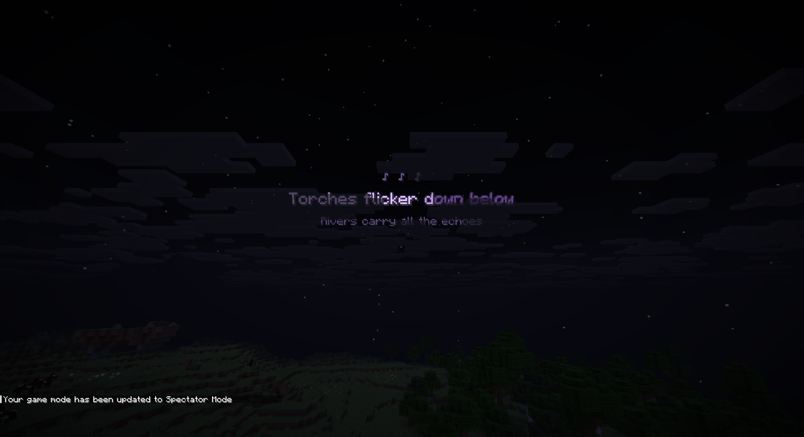

# Beli's SkyLyrics

Synced lyrics for the song you're listening to, glowing in the Minecraft sky.
A free, open-source Fabric mod for Minecraft 1.21.11.



> **Work in progress.** It builds and runs, but it isn't released yet.
> Progress is tracked in [PLAN.md](PLAN.md).

## What it does

- Sees what's playing on your PC: Spotify, a browser tab, or any other player that supports MPRIS on Linux.
- Gets the synced lyrics from [LRCLIB](https://lrclib.net) and shows them line by line, in time with the song.
- **Sky mode** puts the lyrics far away in the sky. **Floating mode** keeps them in front of you.
- Words fade in one by one and light up as they are sung. Four other animations are included, plus an optional glow pulse on each new line.
- A bar at the top of the screen shows the round cover and the line being sung, with the current word highlighted.
- Takes its colour from the album cover. You can also pick your own colour, or use rainbow.
- Lyrics come early or late? Fix the timing once and it's remembered for that song.
- Works with Sodium and Iris shaders. Lyrics stay bright and sit in front of shader clouds and rain.
- A settings screen with a live preview and play/pause/next buttons. Open it with **J** or through Mod Menu.
- A demo mode with a built-in song, so you can try it without any music playing.

## Install

You need **Linux**. Song detection uses MPRIS, which is Linux only. On other systems, only the demo song works.

### With Prism Launcher (easiest)

1. Click **Add Instance**, pick Minecraft **1.21.11**, and choose **Fabric** as the mod loader.
2. Select the instance, click **Edit**, then open **Mods**.
3. Click **Download mods** and add **Fabric API**. You can also add **Sodium**, **Iris** and **Mod Menu** if you like.
4. Click **Add file** and pick the SkyLyrics `.jar` from the [Releases page](https://github.com/arbelonson-source/belis-skylyrics/releases).
5. Start the game, play a song in Spotify or your browser, and look up.

### With the official launcher

1. Run the [Fabric installer](https://fabricmc.net/use/installer/) and install Fabric for **1.21.11**.
2. Download [Fabric API](https://modrinth.com/mod/fabric-api) and the SkyLyrics `.jar`.
3. Put both files in `~/.minecraft/mods`. Create the folder if it doesn't exist.
4. In the launcher, pick the **fabric-loader-1.21.11** profile and press Play.

### Using it

- **J** opens the settings. Change the key under *Options → Controls → Key Binds → Beli's SkyLyrics*.
- The same place has optional keys for play/pause, next and previous song, and "lyrics are early / late" for the song playing now.
- No lyrics showing? Open the settings and look at the **Music** tab. It tells you which player it's following and whether lyrics were found. Some songs simply have no lyrics on LRCLIB.

## Building it yourself

Gradle needs Java 25 to run. The mod itself targets Java 21.

```
JAVA_HOME=/path/to/java-25 ./gradlew build
```

The jar ends up in `build/libs/`.

## License

[GNU AGPL v3](LICENSE). You can use, change and share it, as long as you share your changes under the same license.

Lyrics are not part of this project. They're fetched from LRCLIB while you play.

The fonts are Poppins and Noto Sans Hebrew, both under the SIL Open Font License (see [FONTS-LICENSE.txt](src/main/resources/assets/skylyrics/font/FONTS-LICENSE.txt)).
